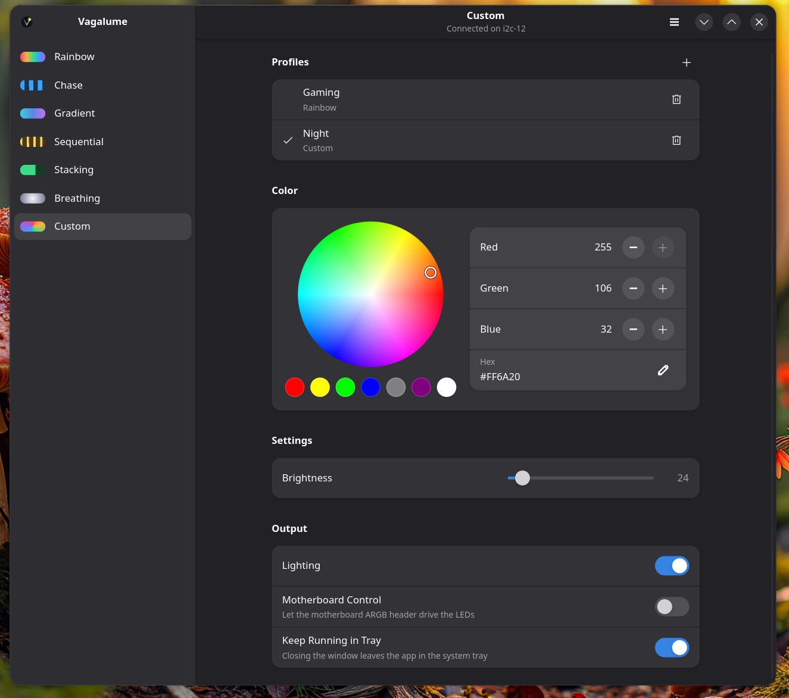
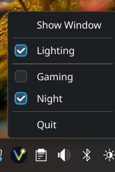

# Vagalume

ARGB lighting control for the ONIX Lumi B580 on Linux, with a native window and a command line.
Unofficial, and not affiliated with ONIX, Intel or any other hardware vendor.





## Supported card

**ONIX Lumi B580** (Intel Arc B580), board ID `8086:207e:a002`. This is the only card tested.

Every other card is refused, including other B580 models and other ONIX cards, because they may
use a different controller. To check yours, run this; it sends nothing to the card:

```sh
flatpak run org.vagalumergb.VagalumeRgb status    # or: vagalume-rgb status
```

`--allow-unknown-board` overrides the check. Only use it at your own risk: the chip at this address
is the card's management controller, and an untested card may respond differently.

## Features

- Seven effects: Rainbow, Chase, Gradient, Sequential, Stacking, Breathing, Custom
- Colour wheel, RGB and hex entry, preset swatches
- Brightness, speed, direction and per-effect settings
- Lighting on/off, and Motherboard Control to let the board's ARGB header drive the LEDs
- Saved settings, restore at login, tray icon
- Profiles for your favourite setups, with Gaming and Night to start from, switchable from the tray
- Lighting on/off from the tray
- English, Brazilian Portuguese, Spanish, French and Chinese, chosen from your system language
- Follows the desktop's light/dark setting and accent colour on KDE Plasma and GNOME

The tray needs a StatusNotifier host. KDE Plasma has one built in; on GNOME install the
AppIndicator extension. Without one, Keep Running in Tray is simply disabled.

## Build

Needs current stable Rust, GTK 4.12+, libadwaita 1.7+, and at runtime the `xe` driver and `i2c-dev` module.

```sh
sudo pacman -S rust gtk4 libadwaita        # Arch
sudo dnf install rust cargo gtk4-devel libadwaita-devel      # Fedora
sudo apt install rustc cargo libgtk-4-dev libadwaita-1-dev   # Debian, Ubuntu

cargo build --release
```

## Run

```sh
vagalume-rgb                               # window
vagalume-rgb status                        # detect the card; sends nothing
vagalume-rgb --dry-run mode breathing --color '#6d4aff'
vagalume-rgb mode custom --color '#0000ff'
vagalume-rgb mode chase --direction right --set response=8
vagalume-rgb led off
vagalume-rgb profile apply Night             # also: profile list, save, delete
vagalume-rgb list                          # every effect's settings
```

`--dry-run` also works with the window: frames are printed and nothing is saved.

To install for your user, adding the menu entry and icon:

```sh
./install.sh            # add --restore to re-apply lighting at login
```

If you can't open `/dev/i2c-*`, install the udev rule:

```sh
sudo install -m644 packaging/70-vagalume-rgb.rules /etc/udev/rules.d/
```

## Flatpak

### Install manually

1. Download `vagalume-rgb.flatpak` from the
   [latest release](https://github.com/Broly1/vagalume-rgb/releases/latest).

2. Install it from the folder you downloaded it to. Flatpak fetches the GNOME runtime from Flathub,
   so add that remote first if you don't have it:

   ```sh
   flatpak remote-add --user --if-not-exists flathub https://dl.flathub.org/repo/flathub.flatpakrepo
   flatpak install --user --bundle vagalume-rgb.flatpak
   ```

3. Set up the host, once. A Flatpak can't do either of these itself. Load the `i2c-dev` module now
   and at every boot:

   ```sh
   sudo modprobe i2c-dev
   echo i2c-dev | sudo tee /etc/modules-load.d/i2c-dev.conf
   ```

   Then install the udev rule that lets you open the card's I2C device:

   ```sh
   curl -fsSLO https://raw.githubusercontent.com/Broly1/vagalume-rgb/main/packaging/70-vagalume-rgb.rules
   sudo install -m644 70-vagalume-rgb.rules /etc/udev/rules.d/
   sudo udevadm control --reload
   sudo udevadm trigger
   ```

4. Open Vagalume from the Utilities section of your app menu, or run:

   ```sh
   flatpak run org.vagalumergb.VagalumeRgb gui
   ```

To update, repeat steps 1 and 2 with the new file. To remove it:

```sh
flatpak uninstall --user org.vagalumergb.VagalumeRgb
```

### Build the bundle

This needs `flatpak-builder`, `cargo` and the Flathub remote, and downloads the GNOME SDK on first
run. The bundle is written to `flatpak-out/vagalume-rgb.flatpak`.

```sh
./packaging/flatpak/build.sh
```

### Notes

The sandbox has `--device=all`, because `/dev/i2c-*` has no narrower permission. Settings live in
`~/.var/app/org.vagalumergb.VagalumeRgb/`, separate from a native install.

To restore lighting at login, use `flatpak run org.vagalumergb.VagalumeRgb restore` as the
service's `ExecStart`.

## Safety

The controller at `0x28` is the card's management controller, not just an LED driver, so:

- Only allowlisted registers can be written.
- Only one transaction shape exists: write, then read one byte. A plain multi-byte read locked up
  this bus during development, so never probe it with `i2cdump` or similar.

Details are in [docs/PROTOCOL.md](docs/PROTOCOL.md).

## Tests

```sh
cargo test
```

These use no hardware.

## License

MIT. See [LICENSE](LICENSE).
